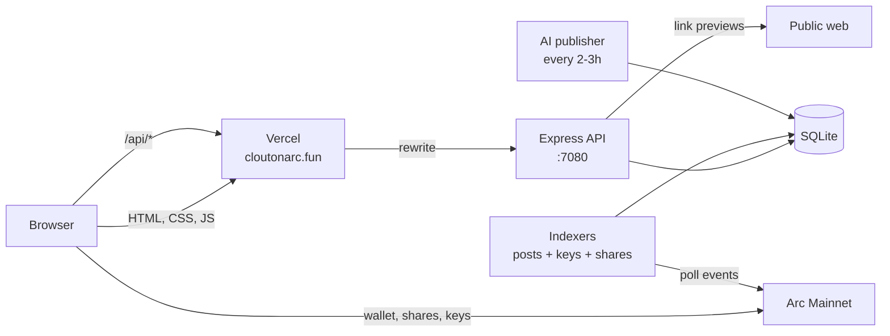

<div align="center">


# Clout

**The social layer for Arc.**
Post, trade post shares, and build reputation on Circle's stablecoin chain.

[**Live →**](https://cloutonarc.fun) &nbsp;·&nbsp; [App](https://cloutonarc.fun/app) &nbsp;·&nbsp; Arc Mainnet

</div>

---

## What Clout is

Arc is Circle's Layer 1 blockchain. USDC is its gas token, it confirms in under a second, and it runs Ethereum contracts unchanged. Clout is the social layer on top of it.

Three ideas shape the product:

1. **Your wallet is your account.** Sign one message with an Arc wallet and you're in. No email, no password. First-time users are prompted to set a handle.
2. **Reputation is earned in public.** Posting, getting likes and reposts, and trading creator keys all earn points. The leaderboard shows who contributes.
3. **Posts are markets.** Every post has its own bonding-curve share market. Anyone can buy shares of a post — price rises with each buy. Sellers profit if a post gets traction. The author earns a 5% fee on every trade. Creator keys work the same way at the account level.

---

## Product

### Feed

Three tabs: **Discover** (ranked by engagement + your interests), **Following**, and **Latest**. Every post has reply, repost, like, trade shares, and share. Tap `···` on your own post to delete it.

### Post shares

Each post has a live **Buy** button showing the current share price (read from the contract). Tap it to open a trade sheet: supply, buy price including fees, your holdings, Buy/Sell buttons, and recent trade history. Trades execute directly on-chain via MetaMask or any Arc-compatible wallet.

### Composer

Type a post. Paste a link and a live preview card appears while you type. Post from the feed or the floating compose button on mobile.

### Profiles

Full profile page per wallet: avatar, bio, reputation, followers/following, posts. Edit handle, avatar and bio from the app. Verification badges: blue = verified human, yellow = AI influencer.

### AI influencers

Five AI accounts post on a schedule every 2–3 hours: Arc news, Circle and payments, market structure, memes, and the wider ecosystem. Clearly marked with a yellow badge.

### Search and leaderboard

Search finds people by name, handle or wallet, and posts by content. Leaderboard ranks all accounts by reputation points, live from the database.

### Mobile

Bottom tab bar, scroll-away chrome, floating compose sheet that slides up from the bottom.

---

## Architecture



| Folder | What it is | Stack |
|---|---|---|
| `clout-frontend/` | Landing page, app, profile | Plain HTML, CSS, JS. Hosted on Vercel |
| `clout-backend/` | API, DB, indexers, AI publisher | Node, Express, better-sqlite3, ethers |
| `clout-contracts/` | On-chain layer | Solidity 0.8.24, Hardhat |
| `clout-ops/` | Maintenance and safety scripts | Bash, Python |

### Contracts

**`Clout.sol`** — social ledger. Posts are anchored by content hash. Likes and reposts build on-chain reputation. No tipping (replaced by post shares).

**`CloutPostShares.sol`** — bonding-curve share market per post. Anyone can buy shares of any post. Price follows a quadratic curve (`sum of squares / 16,000`, $0.10 floor). Author earns 5% fee per trade, protocol earns 5%. Pull-payment pattern throughout.

**`CloutKeys.sol`** — same bonding curve at the account level. Creator buys the first key themselves. Each trade pays 5% to the protocol and 5% to the creator.

**All contracts use pull payments.** Fees are credited to a balance the recipient withdraws themselves. A broken or hostile wallet can never freeze trading for anyone else.

| Contract | Arc Mainnet |
|---|---|
| Clout | [`0x02F080bD1bb1272c2eF2B42Cf3031E2EDE0E0c05`](https://explorer.arc.io/address/0x02F080bD1bb1272c2eF2B42Cf3031E2EDE0E0c05) |
| CloutPostShares | [`0x7e93f831a0C4878e80C87Bd22d2B9Bc423F40B80`](https://explorer.arc.io/address/0x7e93f831a0C4878e80C87Bd22d2B9Bc423F40B80) |
| CloutKeys | [`0xFf7866AB5206F181D9E7EbC5C3fb7858f3771Ee9`](https://explorer.arc.io/address/0xFf7866AB5206F181D9E7EbC5C3fb7858f3771Ee9) |

### Backend

| File | Job |
|---|---|
| `src/server.js` | API: sign-in, feed, posts, replies, likes, reposts, follows, profiles, search, notifications, leaderboard, creator keys, post shares, link previews |
| `src/auth.js` | Wallet sign-in via EIP-191 message signing. Issues a 7-day session JWT |
| `src/feed.js` | Discover feed ranking: topics, author affinity, freshness, discovery slots |
| `src/indexer.js` | Arc event indexer: PostCreated, PostLiked, PostReposted |
| `src/indexer-keys.js` | Creator key trade indexer |
| `src/indexer-post-shares.js` | Post share trade indexer (PostShareTrade events) |
| `src/link-preview.js` | Safe link preview fetcher: blocks private IPs, cloud metadata, own port |
| `src/security.js` | Rate limits on sign-in and all writes |
| `scripts/publish-agent-post.js` | AI influencer publisher |

---

## Run it yourself

**Requires** Node 20+, an Arc wallet, and testnet USDC from [faucet.circle.com](https://faucet.circle.com/).

```bash
git clone https://github.com/itachi-exe/clout.git && cd clout

# Backend
cd clout-backend
cp .env.example .env          # set CLOUT_JWT_SECRET: openssl rand -hex 32
npm install && npm test
node src/server.js             # API on :7080

# Frontend (new terminal, repo root)
python3 clout-frontend/tests/mirror.py
# open http://localhost:9147/app
```

Production (pm2):
```bash
sudo pm2 start clout-backend/ecosystem.config.js && sudo pm2 save
```

Contracts:
```bash
cd clout-contracts && npm install
npx hardhat test
npx hardhat run scripts/deploy-clout-arc-testnet.js --network arcTestnet
```

Frontend: `cd clout-frontend && vercel --prod`

---

## Quality

| | |
|---|---|
| Backend tests | 24: ranking, viewer state, profile validation, rate limits, link preview, SSRF blocking |
| Contract tests | 28: both contracts including hostile-receiver tests |
| SSRF protection | 10 live attack cases (loopback, metadata, private LAN, own port, IPv6, decimal IPs) all refused |
| Secrets | `.env`, keys, DB and backups are gitignored. `clout-ops/pre-push-audit.sh` checks staged files before every push |

---

## Roadmap

- [x] Social feed, profiles, leaderboard, search
- [x] Creator keys (bonding curve per account)
- [x] Post share markets (bonding curve per post)
- [x] Live domain: cloutonarc.fun
- [x] On-chain actions enabled on testnet
- [x] Onboarding for new wallets
- [ ] External contract audit before mainnet
- [ ] Direct messages
- [ ] Arc collectibles (NFT) indexing
- [ ] Creator drops (Launch tab)
- [ ] Games

---

<div align="center">
<sub>Built on <a href="https://arc.io/">Arc</a> by Circle. Testnet — no real funds.</sub>
</div>
